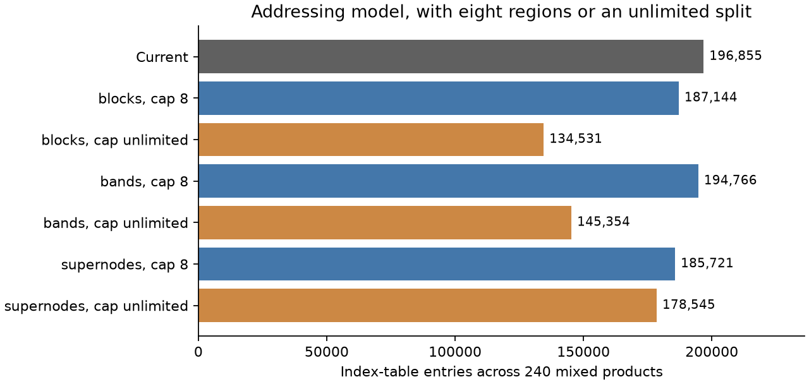

# Structure within sparse patterns, #91

- Structure detection: **build now**, limited to exact rectangles in compact maps. Propose "Split sparse compact maps into affine rectangular regions", one implementation thread. Keep bands and factorization supernodes deferred.
- Per-entry batch patterns: **keep deferred** until a real batch has different structural patterns. The two test reproductions store 8 for 4 supported entries and 4 for 2.
- Automatic dense-value compaction: **keep deferred** until after #225 and #75. The remaining 6,272 computed entries versus 1,344 in the support are seed-axis work already owned by #225.

## Scope and reproducibility

Inspected main at `ce7f8f58e88470cc9baad2c56a3b45f9e3c5572a`, before this notes-only branch.
The brief is #91 under section 2, #292. Inputs were the [compiler-run plan](../compiler_run_2026_11_10/plan.md),
the machine's suite rules, the roadmap's [sparse tensors and open question](../core_compiler_roadmap.md#sparse-tensors),
[#438's packet draft](https://github.com/PREDICT-EPFL/scaly/pull/438), and
the [sparse-kernel implementation notes](../sparse_kernels_2026_11_10/).
No source or test file changed. No devrush code was imported or built.

The 48 Maros-Meszaros archives and preprocessing are exactly those in
[test_sparse_kkt.py](../../../tests/integration/test_sparse_kkt.py). Each problem contributes nine
functions: full and upper Karush-Kuhn-Tucker (KKT) assembly, `P @ x`, `A @ x`, `A.T @ y`,
`G @ x`, `G.T @ y`, `A.T @ diag(w) @ A`, and `G.T @ diag(w) @ G`.
Here `A` holds equality rows and `G` holds non-box inequality rows, including stored zeros in
free rows. This differs from the packet demo's unsplit constraint matrix.
Assembly retains the test's shared upper-triangle values and regularization. Products take
compressed sparse column inputs with the same static patterns. Explicit stored zeros count.
All functions request block lowering, including the `.block()` marker's normal simplification.

The benchmark sample covers all four families with sparse derivatives: chain M=3, N=40,
race cars N=25, npmpc N=12 with its default decoder, and unbumpercars C=8 with its discrete model.
Both the constraint Jacobian and lower-triangle Lagrangian Hessian come from the actual solver
descriptor, the same builders the benchmark sweep uses. This is one size per family, not a sweep
over every horizon, mass count, decoder width or model.

Run from the repository root with `uv run`:

```sh
uv run internal/notes/sparse_structure_2026_11_11/study.py kkt --compile
uv run internal/notes/sparse_structure_2026_11_11/study.py bench --compile
uv run internal/notes/sparse_structure_2026_11_11/addressing.py
uv run internal/notes/sparse_structure_2026_11_11/maps.py
uv run internal/notes/sparse_structure_2026_11_11/census.py
uv run internal/notes/sparse_structure_2026_11_11/coverage.py
uv run internal/notes/sparse_structure_2026_11_11/verify.py
uv run internal/notes/sparse_structure_2026_11_11/report.py
```

`study.py` temporarily observes lowering in memory. It restores the methods afterwards.
The saved [KKT records](kkt.jsonl) and [benchmark records](bench.jsonl) contain each pattern's counts,
map regions, index-map requests, operation counts, source bytes and compile outcome.
[provenance.json](provenance.json) records the toolchain. The table below counts the standalone
generated C body, excluding the public header and its boundary-layout metadata. Rendering uses
one lane, portable C, generic CPU and no vector math library. Each generated body compiles once
with GCC 13.3 using `cc -O3 -fno-math-errno -std=c99 -c`. All 440 compilations succeeded.
The compile durations are single wall-clock observations on busy la015. They describe these
compiler invocations and support no speed or regression claim. No generation or execution time
was measured. Census oracles are rendered, not solved. Building the sparse PIQP example invokes
its existing numerical pattern probe, without timing it.

Floating operation counts expand the optimized program's constant loops and constant-table
bounds and follow procedure calls. They count each scalar arithmetic or mathematical function
evaluation once. They exclude integer addressing, copies and stores. This is a reference-program
count, before the C compiler's optimizations. The checker confirms all 336 product counts against
independent formulas, and all 240 mixed-product table models against the final generated tables.
NumPy rectangle coverage also agrees with exhaustive enumeration on twelve small masks.

## What lowering already does

`LowerCtx.index_at` factors the whole requested index sequence. A residual of length one becomes
arithmetic. Other requests keep only their residual table. It does not independently split an
irregular request at each regular subrectangle. `emit_map` first partitions by operand membership,
then emits straight statements for at most four entries or one loop for the whole region.
"Dense" below means consecutive stored accesses, not a newly detected mathematical rectangle.
Affine indexing may contain integer division for flattened coordinates.

The map-entry columns count stored-entry visits across all intermediate compact maps. An entry
copied through three intermediates counts three times. A region is a table region if any live
read or write map needs a residual table. The last two columns instead count positions in
`index_at` requests, across all access maps. One stored entry can have several such requests.
These units must not be added to the mathematical pattern's stored-entry count.

| Kernel | Straight map entries | Dense map entries | Affine map entries | Table map entries | Affine access-map positions | Table access-map positions |
| --- | --- | --- | --- | --- | --- | --- |
| kkt | 224 | 4734 | 51964 | 346203 | 312675 | 642489 |
| upper | 210 | 8064 | 25452 | 204333 | 216146 | 334761 |
| Px | 0 | 0 | 0 | 0 | 6157 | 98960 |
| Ax | 0 | 0 | 0 | 0 | 2607 | 31599 |
| ATy | 0 | 0 | 0 | 0 | 19189 | 17046 |
| Agram | 3 | 16343 | 0 | 0 | 338902 | 270053 |
| Gx | 0 | 0 | 0 | 0 | 33768 | 28192 |
| GTy | 0 | 0 | 0 | 0 | 46800 | 15555 |
| Ggram | 16 | 29778 | 0 | 0 | 706899 | 220942 |

Mixed products do not use `emit_map`. Classifying their actual stored operand addressing gives
the following counts. A whole traversal is table-based when either its source-slot permutation or
inner-coordinate map retains a residual. Loaded row bounds are separate even when both access
maps are affine. An all-dense-looking traversal can therefore still have a row-pointer table.

| Product | Consecutive stored accesses | Other affine stored accesses | Stored accesses needing a table |
| --- | --- | --- | --- |
| Px | 1390 | 431 | 49393 |
| Ax | 604 | 0 | 15742 |
| ATy | 1 | 603 | 15742 |
| Gx | 8 | 15795 | 13991 |
| GTy | 0 | 15869 | 13925 |

Sparse-sparse products use one accumulator column. They have a single ordered traversal rather
than a partition into geometric regions. The access-map columns above include their operand,
output-row and output-write maps. Their output-entry counts and geometry appear below.
The number of scalar products can exceed either operand's stored-entry count.

The final program includes these tables and operations. A loaded-bound invocation is one entry
to a loop whose bounds load a constant table, expanded over all enclosing loops. It is not a
distinct loop site or the number of inner iterations. Single-row bounds can fold to constants.

| Kernel, 48 each | Floating operations | Index entries | Loaded-bound invocations | C bytes | cc seconds, sum |
| --- | --- | --- | --- | --- | --- |
| kkt | 6655 | 590882 | 0 | 3459659 | 2.713 |
| upper | 6655 | 306276 | 0 | 1785779 | 2.232 |
| Px | 102428 | 94178 | 2689 | 529420 | 1.680 |
| Ax | 32692 | 33137 | 1514 | 218079 | 1.531 |
| ATy | 32692 | 20611 | 3543 | 149127 | 1.596 |
| Agram | 1329704 | 199674 | 28982 | 1060807 | 2.388 |
| Gx | 59588 | 30593 | 2372 | 208268 | 1.531 |
| GTy | 59588 | 18336 | 2767 | 137881 | 1.620 |
| Ggram | 4437440 | 160184 | 22815 | 866269 | 2.280 |

The totals are 1,453,871 index entries and
8,415,289 generated C bytes across 432 separate modules.
Sharing is counted within a module, never between modules.
The full KKT module alone is the first kernel row, not the sum of all nine.

The benchmark derivatives on this snapshot return compact dense values plus separate sparsity
metadata, pending #48. They do not enter #46's compact sparse maps. Their final stored-output
writes nevertheless have measurable addressing. For each entry, `coverage.py` examines its
actual optimized output store and enclosing bounds. A table lookup in any address makes that
write a table write. Otherwise consecutive or broadcast accesses are dense, other table-free
accesses are affine, and a store outside loops is straight. If an entry has several writes, the
table form takes precedence, then affine, dense and straight. Every stored output entry is covered.
These counts describe final assembly, not the earlier arithmetic producing the values.

| Derivative | Stored | Rectangles | Diagonal runs | Column groups | Straight writes | Dense writes | Affine writes | Table writes |
| --- | --- | --- | --- | --- | --- | --- | --- | --- |
| chain_M3_N40/jac | 3489 | 0 | 1206 | 0 | 0 | 369 | 0 | 3120 |
| chain_M3_N40/hess | 3123 | 2640 | 2880 | 0 | 0 | 0 | 0 | 3123 |
| race_cars_N25/jac | 679 | 0 | 354 | 200 | 0 | 104 | 150 | 425 |
| race_cars_N25/hess | 329 | 0 | 154 | 0 | 0 | 30 | 299 | 0 |
| npmpc_N12/jac | 308 | 0 | 100 | 0 | 0 | 126 | 26 | 156 |
| npmpc_N12/hess | 191 | 0 | 113 | 0 | 0 | 0 | 0 | 191 |
| unbumpercars_C8/jac | 236 | 0 | 109 | 176 | 0 | 0 | 0 | 236 |
| unbumpercars_C8/hess | 136 | 124 | 130 | 0 | 0 | 0 | 0 | 136 |

All eight have zero loaded-bound loop sites. Their arithmetic and tables are:

| Derivative | Floating operations | Index entries | C bytes | cc seconds |
| --- | --- | --- | --- | --- |
| chain_M3_N40/jac | 53924 | 78 | 23141 | 0.232 |
| chain_M3_N40/hess | 170401 | 3123 | 91477 | 0.952 |
| race_cars_N25/jac | 11760 | 17 | 12825 | 0.128 |
| race_cars_N25/hess | 39199 | 0 | 66493 | 0.733 |
| npmpc_N12/jac | 240708 | 13 | 16971 | 0.315 |
| npmpc_N12/hess | 350058 | 983 | 31794 | 0.806 |
| unbumpercars_C8/jac | 2258514 | 1034 | 37283 | 0.496 |
| unbumpercars_C8/hess | 8003548 | 1781 | 97722 | 1.204 |

## What structure remains

`structure.py` uses NumPy on coordinates, with no dense array of a workload's logical shape.
Its rectangle coverage is the union of every fully occupied contiguous rectangle at least 4 by 4.
It finds them through four-row intersections, then extends matching intervals. The disjoint count
greedily takes larger rectangles first and rejects overlaps. It is a reproducible candidate cover,
not an optimal partition. "Diagonal runs" means occupied consecutive entries on one diagonal,
with length at least four. This conservative band definition does not call a mostly empty bounding
envelope a filled band. It does include single filled diagonals. Several such runs can form a band.
Column groups are maximal consecutive columns with exactly equal row sets and width at least two.
These are the question's supernode candidates, not factorization supernodes of a filled triangle.
The three coverages overlap and must not be summed. No ordering or permutation is searched.

| Pattern, 48 each | Stored entries | In rectangles | In disjoint rectangles | In diagonal runs | In column groups | Repeated row indices |
| --- | --- | --- | --- | --- | --- | --- |
| kkt | 150042 | 87069 | 62677 | 100388 | 12722 | 10218 |
| upper | 79640 | 43414 | 35220 | 54810 | 0 | 0 |
| Px | 51214 | 44247 | 31056 | 46341 | 5129 | 3730 |
| Ax | 16346 | 3439 | 2947 | 4962 | 3001 | 2117 |
| Gx | 29794 | 17525 | 17268 | 18220 | 17692 | 15830 |
| Agram | 202036 | 164068 | 152612 | 167825 | 112490 | 100081 |
| Ggram | 286101 | 234361 | 224909 | 234429 | 221737 | 215121 |

Repeated row indices are the structural saving `(width - 1) * row_count` from storing one common
row list per column group. They are not a promise to remove that many of today's generated table
entries. Today's affine recovery may already have removed the list. For example PRIMALC1's
`Ggram` output has 52,900 stored entries, all in a dense rectangle, yet its whole kernel has zero
index-table entries and 3,179 C bytes. It already recovers its regular accesses. Detecting its
rectangle again has no table saving.

### Compact maps

`maps.py` examines the actual physical write and read arrays of all 96 assembly functions.
It splits a region into disjoint exact rectangles and a remainder, tries either loop orientation,
and applies the existing affine factorization to every resulting access map. It accepts a split
only when it reduces that region's residual-table entries. The eight-rectangle version takes at
most eight rectangles per original map region, not per function. The unlimited version is an
upper exploration of this greedy cover, not a proposed implementation.

| Compact-map split | Map index entries before | After | Rectangles emitted |
| --- | --- | --- | --- |
| eight | 714616 | 600096 | 440 |
| all | 714616 | 539271 | 1418 |

These are unique residual-table entries used by compact maps before program optimization.
The "before" total differs from the final table total because it omits unrelated gather/layout
maps and because later passes can fold or compress tables. Splits may also change sharing with
those other users. The model does not claim these as final C savings. There are no loaded-bound
loops in either assembly function, so rectangle splits remove zero such loops.

One small case is concrete enough to justify a task. PRIMALC5's full KKT function has 4,887 final
index entries, all belonging to its two irregular compact-map regions. In the model, two disjoint
rectangles make every map arithmetic, with zero residual entries. The present function emits 30,479 C bytes,
286 additions and 8 negations. Its observed C compile duration was 0.040 seconds. A split changes
addressing and loop organization, with the same 294 floating operations. This gives a reviewable
zero-table target without building a general block-sparse representation.

### Products

`addressing.py` separately models rectangle, diagonal-run and equal-row column-group splits for
all 240 mixed products. The remaining entries keep the present row traversal. Each regular
region uses affine source, destination and vector maps wherever possible, retaining a residual
table for irregular physical source slots or common row coordinates. Row pointers remain only
for the generic remainder. Tables share identical residual arrays. One-row pointer tables fold
away, as they do in the actual program. All 240 baseline models match the generated table counts.
The table accepts only winning products. Its eight-region cap is per product. Models for the
three structures are isolated alternatives and their savings cannot be added.



Each alternative keeps a product's current form when it uses fewer entries. These are table
counts, not measured source sizes or times. The unlimited alternatives expose the cost of
allowing many more regions.

| Isolated split | Region cap per product | Winning products / 240 | Index entries removed | Loaded-bound invocations removed | Regular regions emitted |
| --- | --- | --- | --- | --- | --- |
| blocks | 8 | 43 | 9711 | 2140 | 91 |
| blocks | unlimited | 52 | 62324 | 2144 | 350 |
| bands | 8 | 30 | 2089 | 1443 | 43 |
| bands | unlimited | 68 | 51501 | 4164 | 5235 |
| supernodes | 8 | 61 | 11134 | 2170 | 132 |
| supernodes | unlimited | 76 | 18310 | 2286 | 428 |

The baseline contains 196,855 index entries across these products. Rectangles remove up to 62,324,
but the largest individual reductions require many regions. DUAL3's `Px` model falls from 24,322
to 9,862 entries with 51 rectangles, while retaining all 111 loaded row-loop invocations because
the remainder still touches every row. An eight-region cap across the sample saves only 9,711
entries. QCAPRI's equal-row column groups offer 3,577 to 1,030 entries with eight regions, yet
retain all 56 loaded row-loop invocations. This is useful addressing work for a future product
task, but the compact-map target above is the smaller first change.

A dense inner kernel over exact occupied entries changes no floating operation count for these
products. `A @ x` and `A.T @ y` each do one multiplication and one accumulator addition per stored
entry. `A.T @ diag(w) @ A` does `nnz(A) + sum(row_degree(A)**2)` of each, including the first
weighted product. Across the sample the A Grams do 664,852 multiplications and 664,852 additions,
the G Grams 2,218,720 of each. Dense tiling can reuse addresses and loads or expose lanes. It
cannot remove those contributing products. Filling holes inside a candidate rectangle would
instead add operations and could evaluate an absent zero beside infinity, changing semantics.
The model only uses exact occupied regions. No alternate kernel has been implemented or compiled.

## Per-entry patterns and dense support

The repository audit read `examples/`, the benchmark builders, sparse tests, `solvers/ocp.py`,
`solvers/_stage.py`, `solvers/qp.py`, and both plugins' generated interfaces. The dynamic census
covers the eight benchmark oracles, chain's optimal-control problem (OCP) stage form through Fatrop at M=3, N=4, and the
PIQP oracle in `examples/sparse_constant_mpc.py`. It renders the latter's existing sparse mode
and, for comparison, its supported dense mode. It does not claim to instantiate every test or
every arbitrary Function a user could construct. Full records are in [census.json](census.json).

No benchmark oracle or inspected solver path builds a sparse value with per-entry patterns.
Optimal-control stage maps share one stage Function. Fatrop's stage interface deliberately
assembles dense local Jacobian and Hessian blocks. PIQP uses fixed matrices, either dense or
compact values in one static compressed sparse column layout. Neither is a heterogeneous batch.
The test named `test_sparse_arithmetic_with_different_patterns_batches_and_broadcasts` uses two
different operand patterns, with one shared pattern across the batch, not different patterns
inside that batch. Explicit numerical zeros are not a different storage pattern either.

There are small actual examples of unequal per-entry support, both reproduced by `census.py`:

| Main test | Batched shape | Stored entries | Support | Arithmetic / index tables |
| --- | --- | --- | --- | --- |
| `test_sparse_select_masks_survive_nesting_and_pattern_normalization`, stack and concat forms | 2 by 2 by 3 | 8 | 4 | 2 square roots / 0 |
| `test_sparse_constants_return_scipy_and_keep_batched_shared_patterns`, sparsify case | 2 by 3 by 4 | 4 | 2 | 0 / 0 |

The first takes the union of two different patterns. The second unions the per-entry support
when explicitly sparsifying a dense constant. They show the representation cost and correct
current behavior, not a workload whose cost warrants a new batch format. Seed-axis arrays with
different supports are real and larger, but #225 already owns their nonzero seed-entry traversal.

Dense-typed values with mostly empty support do reach lowering. `census.py` observes `Expr.support`
and allocation, then counts materialized stores after scalar expansion and folding, before
workspace packing. Support is the compiler's upper bound on entries that may be nonzero, not a
count of numerical nonzeros. A computed write below means its value is not the literal zero. Writes in
callees include their call multiplicity. It counts visits, not distinct mathematical coordinates,
and not arithmetic operations. A scatter may write zeros and then update a smaller support.

| Actual intermediate | Dense entries | Support entries | Computed writes | All writes |
| --- | --- | --- | --- | --- |
| Chain Jacobian, mapped stage derivative | 4,320 | 3,120 | 3,120 | 4,320 |
| Race-car Jacobian, mapped stage derivative | 500 | 425 | 425 | 500 |
| Unbumpercars Jacobian, one seed gather | 3,136 | 196 | 3,136 | 3,136 |
| Unbumpercars Hessian, one seed gather | 3,136 | 196 | 3,136 | 3,136 |
| Unbumpercars Hessian, final seed-axis add | 6,272 | 1,344 | 6,272 | 6,272 |
| Unbumpercars Jacobian, seed scatter | 896 | 56 | 56 | 952 |
| Fatrop initial Jacobian block | 81 | 9 | 9 | 81 |
| Fatrop padded first-stage Hessian contribution | 156 | 9 | 117 | 156 |
| PIQP example, linear term | 7 | 4 | 4 | 11 |

The first two already compute only the supported values, but still write required dense zeros.
The gathers and add show genuine remaining work over zero seed-entry pairs. The scatter already
limits arithmetic updates to its support, while retaining dense initialization. Intermediate
buffers that disappear after fusion are not counted as though they remain allocated. For example
several 6,272-entry multiplication intermediates disappear, while the final add in this table stays.
The `allocations` records retain both cases so they can be distinguished.
Fatrop also has a small non-seed copy opportunity in the padded first-stage contribution.
Its initial and terminal derivative blocks already compute only their supports, and the plugin
requires dense stage blocks at its boundary. The remaining 117 copy writes do not justify a
general compaction mechanism. They should remain in the follow-up census rather than be counted
as seed-axis arithmetic.

The PIQP dense comparison also lowers a constant 49-entry matrix with support 7 and a constant
28-entry matrix with support 10. The existing sparse option emits their compact values instead.
They are fixed constants at a deliberately dense solver boundary, not 49 or 28 floating
computations to remove. Changing that boundary automatically would violate its selected interface.
The sparse example's only partially supported allocated value is its seven-entry linear term.

## Recommendation and task cut

For structure detection, build the compact-map subset now. Proposed issue title:
**Split sparse compact maps into affine rectangular regions**.
One implementation thread should change the private region planner and its focused tests.
It should recognize exact occupied rectangles whose physical read and write maps become affine,
reuse `LowerCtx.index_at` and the existing loop emitter, and keep an irregular remainder.
It should not introduce a core operation, a block-sparse tensor type, a public option, a new
layout, reordered boundaries, band detection, supernode detection or product scheduling.
Keep a split only when it reduces addressing, and bound region growth using the emitted source
evidence rather than enabling the unlimited geometric cover.

A reviewer can check completion without an execution-time measurement:

- PRIMALC5's full assembly computes the same values and keeps its stored pattern, with zero
  kernel index-table entries, fewer than 30,479 C bytes and the same 286 additions and 8 negations.
- A focused NumPy differential checks rectangle-plus-remainder maps with unequal operand
  membership and compressed sparse column, row and coordinate layouts. Holes remain absent,
  including beside infinity. The test fails when a rectangle index or membership is perturbed.
- All 48 full and upper assemblies preserve values and patterns, do not grow their generated
  C source, and introduce no loaded-bound loops. Dense C snapshots remain byte-identical.
- The regular cases keep their table-free form. The ordinary full compiler checks pass. The
  pull request reports source bytes, reference operation counts and C-only compilation results.

Do not create a general product block planner in the same thread. Current matrix-vector kernels
have bounded stored-size tables, and extra regions can outweigh their savings. Revisit bands or
product column groups when a recurring sparse product needs them after loaded-bound lanes in
#71, or when #54 has a concrete factor/solve update. The present evidence supports the smaller
compact-map cut, not a speed claim for a block kernel.

For per-entry batch patterns, keep deferred. Revisit for a real mapped collection of different
stage models, heterogeneous meshes or matrices whose union stores substantially more than the
sum of their individual patterns. It should come with a concrete Function, stored sizes and a
consumer. The current two-entry test batches do not justify changing the shared-pattern contract.
Do not use this part of #91 to duplicate #225's seed-axis representation.

For automatic dense-value compaction, keep deferred. Finish #225's nonzero seed-entry traversal
and #75's demanded entries, then rerun these same unbumpercars cases. Revisit #91 if a non-seed
internal dense value still computes and stores a large mostly empty support after those changes.
Keep dense inputs and outputs fixed by their declared types. This requires no new issue now.
No proposed issue has been created by this investigation.

## What devrush's sparse factorization would need

Read only with `git show origin/devrush:<path>`. The relevant files are
`src/scaly/linalg/symbolic.py`, `src/scaly/linalg/sparse_factor.py` and
`src/scaly/linalg/ops/sparse_ldl.py` on that frozen branch.
The numerical algorithm factors a symmetric permuted matrix as `L D L.T`, called an LDL factorization.
Here `L` is unit lower triangular and `D` is diagonal.
Its useful structure is in the filled factor after ordering and symbolic analysis, not merely
in the original KKT pattern counted above. No factorization, ordering study or fill analysis
was built or run for this investigation.

`SymbolicLDL.chunks` groups up to eight entries in a row's update list when the corresponding
factor columns have identical suffix row lists from that row down. It supplies `ck_ptr`, `ck_q`,
`ck_width` and `ck_len`, alongside the factor's column pointers, row indices and row-to-column
positions. The numeric update computes one scale per participating column, then visits each
shared destination row once and accumulates all columns in registers. For width w and a shared
suffix of length h, this retains w*h multiplication/addition pairs but reduces destination
loads, stores and shared row-index visits from w*h to h. For w=8 that is eight to one. Unlike
a one-use assembly map, this is a repeated numeric consumer of the shared structure.

`solve_chunks` uses fundamental triangular supernodes: column j's row list starts with j+1,
and its remaining suffix equals column j+1's row list. These are not equal whole-column row
patterns. The forward solve treats the triangular rows inside the chunk in order, then updates
each common row below it once. Symbolic fill, dependency order and scratch clearing must remain
visible. A generic detector over the original pattern is insufficient.

Devrush emits one width-specific path for each width actually present, selected by a zero-or-one
loop. Main's #54 should express its algorithm as library Functions with carried loops, runtime
indexing and in-place updates, on the roadmap's existing primitives. It needs build-time symbolic
factor/chunk metadata and a measured source-size decision for width specialization. It should
reuse index arithmetic and lanes where applicable. It should not copy devrush's registered ops,
string-keyed table protocol or lowering implementation. The roadmap explicitly leaves the number
of width branches open. This is the workload that would justify revisiting supernodes.

## Limits

No run time, generation time, speedup, lane efficiency or solver iteration effect was measured.
The C compilation observations came from a busy machine. The geometric and addressing
alternatives are NumPy models, not implemented kernels. Their source size and compile time
cannot yet be measured. No dense-kernel arithmetic reduction is claimed.
The band and column-group candidates are conservative and use the existing coordinate order.
There is no search for permutations, relaxed supernodes or partly filled blocks.
Only one size per benchmark family was generated, and the audit does not dynamically execute
the whole example/test corpus. Custom derivative supports are taken as the compiler reports
them. This note leaves production correctness to the existing tests and the proposed change's
required differential tests. It does not modify the roadmap or close #91.

## Per-problem evidence

Each row sums nine separately generated modules. [kkt.jsonl](kkt.jsonl) retains the per-function
and per-pattern details, [addressing.json](addressing.json) the 240 product models,
[maps.json](maps.json) the 96 assembly models, and [coverage.json](coverage.json) the eight
benchmark output classifications. The counts are reproducible without a performance run.

| Problem | KKT stored entries | Index entries, nine modules | Floating operations, nine modules | C bytes, nine modules | cc seconds, sum |
| --- | --- | --- | --- | --- | --- |
| CVXQP1_S | 1018 | 11215 | 3412 | 66643 | 0.330 |
| CVXQP2_S | 845 | 9488 | 2478 | 58416 | 0.405 |
| CVXQP3_S | 1191 | 12936 | 4346 | 75035 | 0.407 |
| DPKLO1 | 3360 | 39143 | 82362 | 208369 | 0.395 |
| DUAL1 | 7202 | 71163 | 29194 | 411521 | 0.426 |
| DUAL2 | 9113 | 90163 | 37042 | 521665 | 0.371 |
| DUAL3 | 12328 | 122163 | 49742 | 721453 | 0.415 |
| DUAL4 | 5674 | 55983 | 22898 | 323572 | 0.356 |
| DUALC1 | 4166 | 10593 | 47050 | 76166 | 0.426 |
| DUALC2 | 3484 | 8776 | 32630 | 65456 | 0.428 |
| DUALC5 | 4790 | 12066 | 49628 | 85103 | 0.421 |
| DUALC8 | 8615 | 21516 | 89678 | 141869 | 0.376 |
| GENHS28 | 84 | 774 | 380 | 16984 | 0.359 |
| HS118 | 110 | 1141 | 514 | 17603 | 0.406 |
| HS21 | 7 | 6 | 30 | 11045 | 0.272 |
| HS268 | 80 | 298 | 470 | 15312 | 0.353 |
| HS35 | 14 | 81 | 58 | 12298 | 0.259 |
| HS35MOD | 17 | 93 | 68 | 14180 | 0.313 |
| HS51 | 26 | 286 | 110 | 15061 | 0.318 |
| HS52 | 26 | 286 | 110 | 15061 | 0.317 |
| HS53 | 26 | 286 | 110 | 15061 | 0.280 |
| HS76 | 31 | 312 | 162 | 14891 | 0.275 |
| LOTSCHD | 127 | 1243 | 1426 | 18890 | 0.269 |
| PRIMAL1 | 12040 | 154714 | 839230 | 851188 | 0.449 |
| PRIMALC1 | 4379 | 7150 | 965554 | 54429 | 0.311 |
| PRIMALC2 | 3472 | 5791 | 757690 | 46235 | 0.261 |
| PRIMALC5 | 4887 | 8054 | 1332840 | 59777 | 0.260 |
| QADLITTL | 1053 | 14435 | 12480 | 83692 | 0.365 |
| QAFIRO | 225 | 2543 | 1270 | 29551 | 0.346 |
| QBEACONF | 7203 | 102936 | 548358 | 566019 | 0.408 |
| QBORE3D | 3509 | 48777 | 64416 | 266186 | 0.484 |
| QBRANDY | 4815 | 78062 | 169640 | 405074 | 0.527 |
| QCAPRI | 5882 | 74349 | 64974 | 404762 | 0.429 |
| QE226 | 7338 | 113443 | 253760 | 608825 | 0.589 |
| QGROW7 | 6319 | 75581 | 120636 | 415216 | 0.516 |
| QISRAEL | 6154 | 81174 | 187152 | 429505 | 0.428 |
| QPCBLEND | 1133 | 13650 | 13532 | 79750 | 0.422 |
| QPCBOEI2 | 2701 | 43377 | 90608 | 223869 | 0.452 |
| QPTEST | 14 | 45 | 56 | 13947 | 0.255 |
| QRECIPE | 1729 | 20821 | 18230 | 117300 | 0.340 |
| QSC205 | 1530 | 16987 | 7010 | 99581 | 0.358 |
| QSCAGR7 | 1047 | 12468 | 7054 | 76955 | 0.381 |
| QSHARE1B | 2686 | 35621 | 43342 | 192443 | 0.375 |
| QSHARE2B | 1644 | 17917 | 17050 | 102791 | 0.345 |
| S268 | 80 | 298 | 470 | 15177 | 0.291 |
| TAME | 9 | 19 | 34 | 11728 | 0.236 |
| VALUES | 7847 | 55624 | 98110 | 325983 | 0.324 |
| ZECEVIC2 | 12 | 24 | 48 | 13652 | 0.244 |
